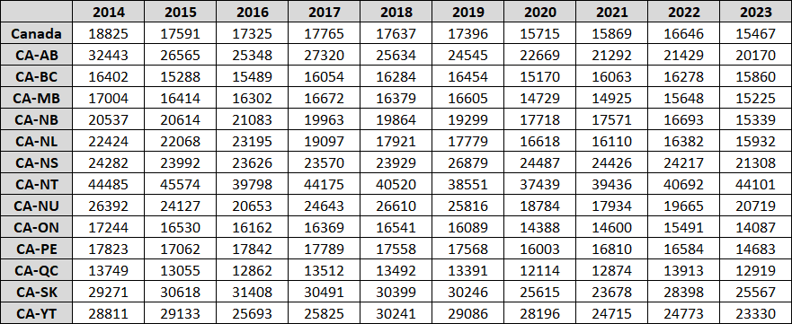
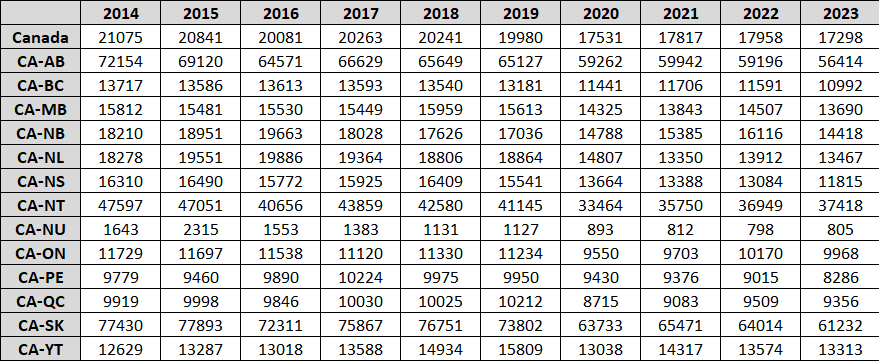
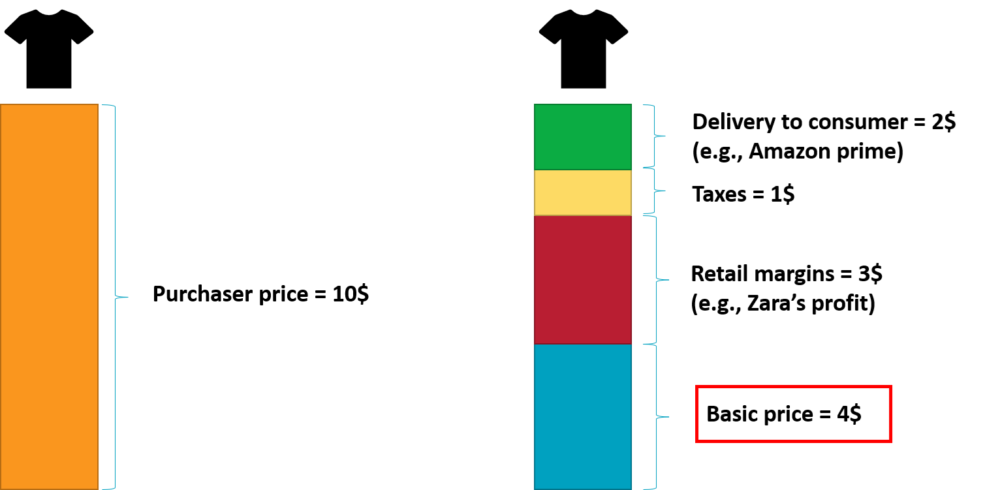

## _OpenIO-Canada v2.12_

Python class creating Multi-Regional symmetric Environmentally Extended Input-Output (MREEIO) tables for Canada. OpenIO-Canada 
operates at the provincial level (13 provinces). It can thus be used to compare the environmental impacts of value chains
or consumption by households from any specific province.

The database covers reference years from 2014 to 2023.

OpenIO-Canada covers 492 commodities, 33 GHGs, around 300 pollutants in 3 compartments (air, water and soil), 
67 mineral resources, water consumption and energy use.

OpenIO-Canada is connected to the Exiobase global MRIO database to model value chains happening outside Canada.

**_IMPORTANT_** While openIO-Canada v2.12 CAN operate with Exiobase versions 3.9.4, 3.9.5, 3.9.6, 3.10.1, 3.10.2 we do NOT recommend 
using these versions of Exiobase, as there are significant mistakes in the modeling of the mining sector. Instead use the
latest available version from v3.11.2.

Only interested in the emission factors of the latest year? You can access them already extracted here: https://doi.org/10.5281/zenodo.5553376

### Getting started

Clone the repository (or download it) and install the different libraries required to run this Python class (requirements.txt). 
Go to the doc folder and start with the Running_openIO-Canada.ipynb file to generate the IO tables. You can then explore 
how to use openIO-Canada with the other notebooks.

### Carbon footprint per capita estimates
Using openIO-Canada v2.12 (with capitals endogenized) and population estimates from StatCan, we can derive carbon 
footprints per capita for all 13 provinces of Canada, and Canada as a whole, from 2014 to 2023, following a consumption approach.

We can see that the national carbon footprint per capita is around 15.5tCO2eq, which represents its lowest level since 2014.
Similar trends can be observed across provinces, with 2023 often being the year with the lowest per capita carbon footprint.
In particular, let's highlight the per capita carbon footprint of Alberta, which decreased from 32tCO2eq/hab. to 20tCO2eq, below
Saskatchewan and Nova Scotia.
These decreases should most likely be due to two factors:
- there was a surge in population in 2023 across Canada (1.3 million more inhabitants), resulting in a drop in per capita
carbon footprint
- Electric power generation emissions plunged acros provinces. One notable exception is Ontario which switch some of its
nuclear power generation for natural gas power plant, which increased its electricity power generation emissions by nearly 50%.

We can also look at the same results, but through a territorial approach.

The national carbon footprint following a territorial approach is around 17tCO2eq. 2023 is also the year with the lowest
territorial GHG emissions since 2014. This is once again driven by decreased across the board, but more importantly, in
Alberta and Saskatchewan which both have tremendous per capita footprint, due to petroleum extraction activities. Except
for these two provinces, the territorial approach yields a smaller carbon footprint than the consumption one, highlighting
than other provinces are mostly importers of GHG emissions, rather than producers/exporters.

### Classification detail
The classification used by openIO-Canada is the Input-Output Commodity Classification (IOCC) from StatCan. Unfortunately, 
this classification does not provide a fully detailed structure. It is thus complicated to know where each commodity/service
is actually classified. We recreated this structure based on comparisons with the NAPCS classification. You can find this
structure in the doc/OpenIO-Canada-classification-structure.xlsx file.

### Endogenization of capitals
OpenIO-Canada supports the endogenization of capitals, allowing the user to obtain the tables either with or without the
endogenization. Endogenization consists in integrating the use of capital goods (i.e., any good that is used more than a 
year, such as a building, a machine or a software) in the value chain description of all commodities/services. In other words, 
gross capital formation is typically a final demand and with endogenization it becomes part of the intermediate economy.  
So what? After endogenization of capitals there are two main consequences:
1. The emission factors include the impacts of capital goods on the environment. Without endogenization, it's like having
a cradle-to-gate emission factor without the infrastructure. Not performing endogenization of capitals thus results in 
underestimated emission factors.
2. The national/provincial emission estimates are underestimated. While endogenization of capitals does not (or really 
marginally) affect the impact of domestic capital goods, it also affects capital goods from other countries. In other words,
national emission levels, following a consumption approach, without endogenization of capitals includes domestic capital 
goods but excludes foreign capital goods that were used to produce imported commodities/services. Not endogenizing capitals
thus results in an underestimation once again.  
Do note however, that endogenization introduces a lot of uncertainties and that studies currently typically do not endogenize capitals.  
You can read more on how endogenization of capitals was achieved in the openIO-Canada model in the methodology document, in the doc folder.  
For more information on endogenization in general, you can refer to these articles: https://doi.org/10.1021/acs.est.8b02791 https://doi.org/10.1111/jiec.12931

### Basic vs purchaser price
OpenIO-Canada operates at basic price, and so does exiobase, thus ensuring consistency. However, openIO-Canada can still 
provide emission factors at purchaser price for its users. We use average impact of trade and downstream transportation
to estimate these purchaser price emission factors.  
What's basic and purchaser price you ask?  
The purchaser price is the price that is paid by the final consumer. The basic price is the price of the manufactured 
commodity. These are different, since there are additional costs between the price of the manufactured commodity and the 
final price paid by the consumer. The figure below illustrates the difference in the case of a t-shirt.
  
While the price of the manufactured t-shirt is 4$, the final consumer pays that t-shirt 10$ because the retailer/wholesaler
makes a profit on the sale. Then, said retailers also had to transport the t-shirt to its warehouse or directly to the 
retail shop, and these costs are passed down to the final consumer. The final cost of the t-shirt could also simply 
include a delivery to the consumer. Finally, taxes are being paid on the t-shirt.  
In most cases, users of openIO-Canada will not have access to the breakdown between basic price/retail margins/downstream 
transportation margins/taxes, and so in the majority of cases, the purchaser price emission factors should be used. If 
somehow you have access to this breakdown, using the basic price emission factors will allow for a more accurate assessment.

### Contact
maxime.agez@polymtl.ca

### Citation
https://doi.org/10.5281/zenodo.8200655

## 📊 Community Adoption

### Scientific articles using openIO-Canada
- Antoine Théron, Guillaume Escoffier, Jean-François Bussières (2026). Estimation des gaz à effet de serre générés par les médicaments en établissement de santé: comparaison de deux méthodes, Annales Pharmaceutiques Françaises, ISSN 0003-4509,https://doi.org/10.1016/j.pharma.2026.08.001.
- Santiago Zuluaga, Shoshanna Saxe (2025), Leveraging building permit data for large-scale embodied carbon and circularity assessment of residential building construction, Environ. Res.: Infrastruct. Sustain. 5 035015. https://doi.org/10.1088/2634-4505/adfc95
- Wambersie, L., & Ouellet-Plamondon, C. (2024). Developing a comprehensive account of embodied emissions within the Canadian construction sector. Journal of Industrial Ecology, 1–14. https://doi.org/10.1111/jiec.13548
- Yoffe, H., et al. (2024). Mapping construction sector greenhouse gas emissions: a crucial step in sustainability meeting increasing housing demands. Environmental research - Infrastructure and sustainability. https://doi.org/10.1088/2634-4505/ad546a
- Anne de Bortoli, Maxime Agez (2023). Environmentally-extended input-output analyses efficiently sketch large-scale environmental transition plans: Illustration by Canada's road industry, Journal of Cleaner Production, Volume 388, 2023, 136039, ISSN 0959-6526, https://doi.org/10.1016/j.jclepro.2023.136039.

### Public and private organizations reports using openIO-Canada

The openIO-Canada database is utilized by public and private organizations for carbon accounting and environmental modeling.

| Entity                                     | Use Case                      | Source                                                                                                                                                                                                                          |
|:-------------------------------------------|:------------------------------|:--------------------------------------------------------------------------------------------------------------------------------------------------------------------------------------------------------------------------------|
| **Shared Services Canada**                 | Procurement Footprinting      | [Official Report](https://ciraig.org/wp-content/uploads/CIRAIG_SSC_EnvFootprint_Procurements_Final_report_30-11-2020-1.pdf)                                                                                                     |
| **RECYC-QUÉBEC**                           | Circular Economy Modeling     | [2025 Study](https://www.recyc-quebec.gouv.qc.ca/sites/default/files/documents/etude-reemploi-aviseo.pdf) / [2025 Report](https://www.recyc-quebec.gouv.qc.ca/sites/default/files/documents/rapport-indice-circularite2025.pdf) |
| **Ville de Montréal**                      | Community Footprint Esimating | [Official Report](https://portail-m4s.s3.montreal.ca/pdf/ciraig_vdm_inventaire_ges_conso_2017.pdf)                                                                                                                              |
| **Public Services and Procurement Canada** | Procurement Footprinting      | [Official Report](https://canadacommons.ca/artifacts/21670110/carbon-footprint-of-procurements-by-public-services-and-procurement-canada/22570299/)                                                                             |
| **Treasury Board Secretariat of Canada**   | Procurement Footprinting      | [Official Report](https://ciraig.org/wp-content/uploads/CIRAIG_TBS_GHG_Footprint_Procurement_final_w_exec_summary_EN.pdf)                                                                             |
| **Réseau universitaire québécois en développement durable (RUQDD)**                                 | Methodological Guide          | [Official Report](https://doi.org/10.60918/23208)                                                                             |

